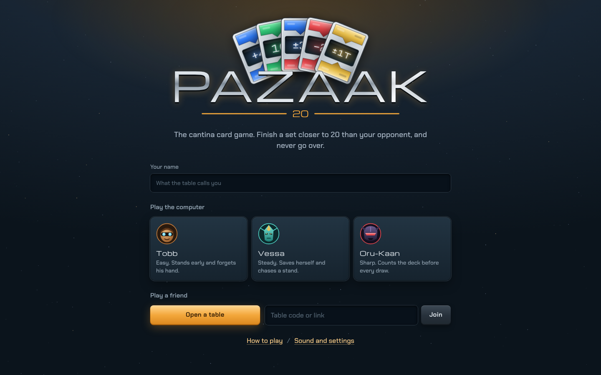
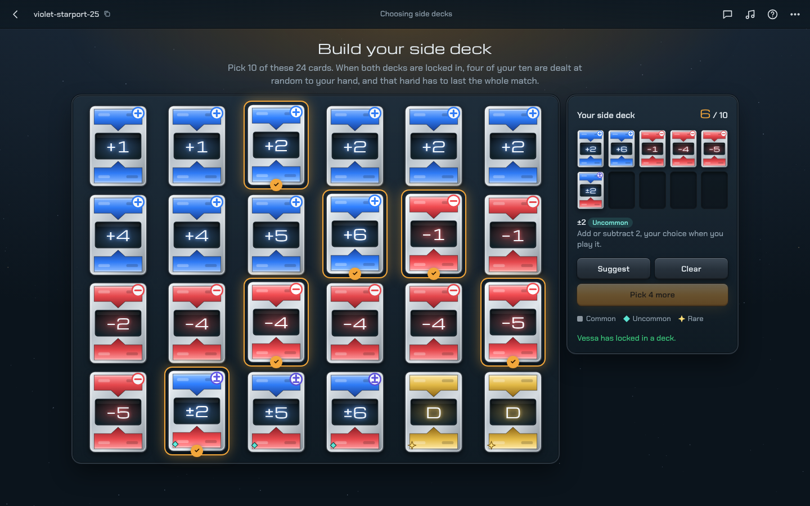
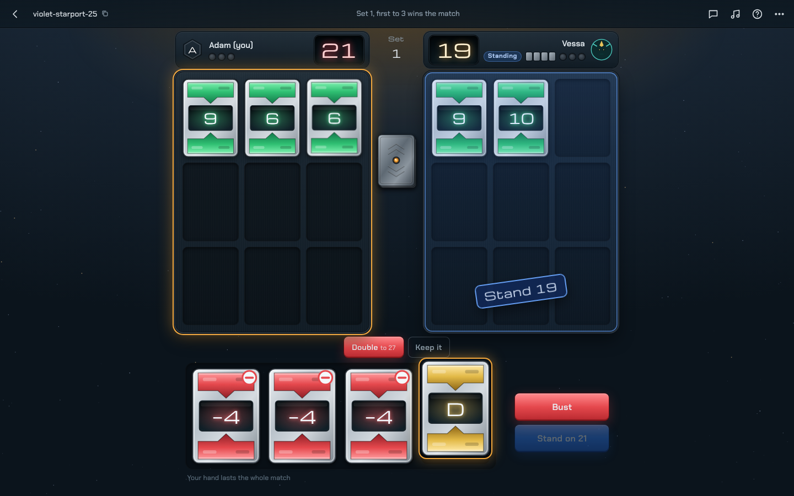
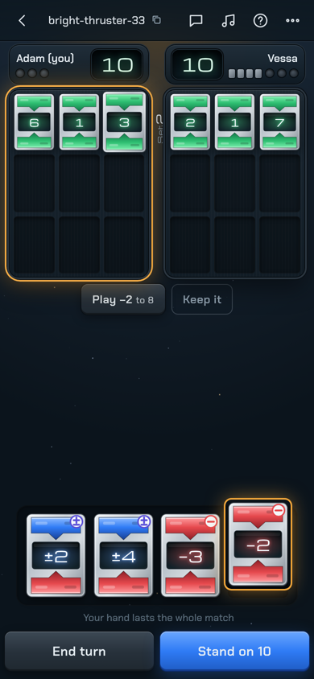

# Pazaak

A self-hosted, real-time Pazaak table for two, played in the browser. Open a table, send the link, and play a friend from your phones, or take on one of three computer opponents.

Each player builds a side deck of 10 from 24 randomly dealt cards. Four of those become a hand that has to last the whole match. Sets are played to 20, and the first to win three sets wins the match.

Pazaak runs on the same server design as [Swipe](https://github.com/au12/swipe): one small Node process, rooms behind a link, no accounts, no database, no build step.

| Home | Side deck | The table | Phone |
| --- | --- | --- | --- |
|  |  |  |  |

## What you get

**The game**

- The server runs the rules: the main deck, one hand card per turn, ending your turn or standing, the automatic stand on 20, busting, the full board, ties and the tiebreaker, first to three sets.
- A side-deck screen with 24 cards dealt at random by rarity (see [Rarity](#rarity)). Tap to pick 10, or let **Suggest** pick a balanced deck. Point at any card to see what it does.
- Your four hand cards are dealt with a flourish once both decks are locked in, and stay with you until someone wins three sets.
- Tap a hand card and the status line shows exactly what it will do: "Play −3 to 17", or both choices for a ± card. Playing it to exactly 20 lights the button gold; one that would leave you over 20 shows red.
- Over 20 with a card that can save you? The game tells you, and the End turn button becomes **Bust**. With nothing that can save you, the set is called after a short pause.
- Three computer opponents, each with a face and a temperament: Tobb (easy), Vessa (steady) and Oru-Kaan (sharp, counts the cards left in its deck).
- An optional turn clock (20 to 60 seconds). When it runs out the turn is ended for you, which busts you if you are over 20.
- If a player drops out mid-match, the other player (or the host) can let the computer play their seat until they come back.
- Rematches: both players agree and a fresh match starts, with fresh pools of 24.
- A record of matches won at each table.
- Quick emotes ("Pazaak!", "Good game", "Lucky draw"…) that pop up over the sender's side of the table, plus a small chat.
- **How to play**: the rules, every side card with its rarity, and a recorded match to watch.

**The look**

- A cantina holotable in brushed durasteel, under one amber lamp. Card art is drawn as SVG, so it is sharp on any screen.
- Cards fly from the deck shoe to the board and turn over on the way. Your hand cards fly from your hand; your opponent's turn face up as they land. Flip cards turn the matching cards over in gold. Totals roll like counters and glow gold on 20 and red over it. Busts shake the board, wins light a pip with sparks, a set's cards are swept away before the next, and winning the match ends in a shower of cards.
- The original Pazaak sound effects and three cantina tracks. Music and effect volume are separate, and there is a calmer-animations setting (the system's reduced-motion setting is respected too).
- Built for a phone held upright as much as for a desktop: both boards side by side, your hand and the buttons in thumb reach.

**The room**

- No accounts. A table is a link like `/r/dusty-cantina-42`.
- The first two people in take the seats; anyone after that watches. Watchers never see either hand.
- Nobody is sent a card they could not see at a real table: your own pool and hand only. The other player's hand is sent as backs until the match is over, when whatever they never played is shown.
- The first person in is the host: they set the turn clock and can free a seat.
- Players who drop reconnect to their seat with their hand.

**Hosting**

- One dependency (`ws`). Fonts, sounds, music and card art are bundled. No outside requests.
- Rooms are saved to a JSON file and survive a restart, mid-match included.
- An admin page at `/admin` lists every table, who is in it and how the match stands, and lets you keep or delete tables.
- Works behind a reverse proxy, on a sub-path if you want.

## Rarity

The 24 cards on the side-deck screen are dealt independently, each one by weight. Repeats are allowed (a pool can hold two +3s), except the ±1T tiebreaker: never more than one per pool.

| Card | Rarity | Chance per card |
| --- | --- | --- |
| +1, +2 | Common | 8.3% each |
| +3 | Common | 7.5% |
| +4 | Common | 6.6% |
| +5 | Common | 5.0% |
| +6 | Common | 4.2% |
| −1 to −6 | Common | the same as the plus cards |
| ±1 | Uncommon | 2.5% |
| ±2, ±3 | Uncommon | 4.2% each |
| ±4 | Uncommon | 3.3% |
| ±5 | Uncommon | 1.0% |
| ±6 | Uncommon | 0.8% |
| 2&4, 3&6, D | Rare | 1.2% each |
| ±1T | Rare | 0.8% |

A typical pool is about 19 common cards, 4 uncommon and 1 rare. About a third of pools have no rare card at all. The weights are `COMMON`, `UNCOMMON` and `CATALOG` at the top of [`public/js/rules.js`](public/js/rules.js).

## How the rules were read

The rule sheet leaves a few things open. These are the calls the game makes; each lives in one small place in [`public/js/rules.js`](public/js/rules.js) or [`server/game.js`](server/game.js).

- **Going over 20 is judged when your turn ends.** A draw that takes you past 20 can still be saved by a minus card in the same turn. End the turn (or stand) above 20 and you bust, losing the set on the spot. If nothing in your hand can bring you back, the set is called after a short pause rather than waiting for you to press the button.
- **"If both players bust"** can't happen under that reading, because the first bust ends the set. The comparison still handles it (whoever went over first loses) in case the rules change.
- **Flip cards** turn over every matching value on your board: main deck cards and side cards alike, positive to negative and back. The flip card itself counts for nothing.
- **The double card** is placed as a copy of the main deck card you drew this turn, at that card's current value, so the pair counts twice.
- **The tiebreaker** has to be on your board that set to break a tie. It plays as +1 or −1 like any ± card. If both players played one, the set is still a draw.
- **A full board wins at once.** The moment your ninth card lands without taking you over 20, the set is yours. Side cards take board spaces too.
- **Reaching exactly 20** stands you immediately, whether it came from a draw or a hand card.
- **Who opens a set** alternates. Who opens the first set is decided at random.
- **The main deck** is four each of 1 to 10, shuffled fresh for each player every set.
- **Forfeiting** gives the match to the other player.

## The computer opponents

- **Tobb (easy)** stands on 16 or 17 and forgets his hand about half the time.
- **Vessa (steady)** always saves herself when she can, stands on 18, chases an opponent who has stood, and spends a card to reach 20 from 15 or more.
- **Oru-Kaan (sharp)** does the same but counts the main cards left in its deck, and what its hand could rescue, before risking a draw on 16 or 17. It also drafts heavier on minus and ± cards.

Over thousands of computer-vs-computer matches, Tobb loses about 85% of matches to Vessa. Beyond "sensible", though, Pazaak is mostly the luck of the draw: Oru-Kaan's edge over Vessa is only a couple of percent. A Monte Carlo look-ahead was tried and did no better, so the simpler version stayed.

## Run it

### Docker Compose

```sh
git clone <this repo> pazaak && cd pazaak
docker compose up -d --build
```

Open <http://localhost:3002>. Saved rooms live in `./data`. (The compose file maps host port 3002 so Pazaak can run next to Tradecraft on 3000 and Swipe on 3001.)

### Unraid

The repository includes a GitHub Actions workflow ([`.github/workflows/docker-image.yml`](.github/workflows/docker-image.yml)) that builds the image and publishes it to `ghcr.io/<your-username>/<repo-name>:latest` on every push.

1. Push this project to your own GitHub repository and wait for the **Build image** run on the Actions tab to go green.
2. Make the package public once: your GitHub profile, **Packages**, the package, **Package settings**, **Change visibility**.
3. In the Unraid terminal:

   ```sh
   mkdir -p /mnt/user/appdata/pazaak
   chown -R 99:100 /mnt/user/appdata/pazaak
   ```

4. Docker tab, **Add Container**, Advanced View on:

   | Field | Value |
   | --- | --- |
   | Name | `pazaak` |
   | Repository | `ghcr.io/<your-username>/<repo-name>:latest` (all lower case) |
   | Network Type | Bridge |
   | WebUI | `http://[IP]:[PORT:3000]` |
   | Extra Parameters | `--user 99:100` |
   | Port | container `3000`, host `3002` |
   | Path | container `/data`, host `/mnt/user/appdata/pazaak` |
   | Variable | `ADMIN_PASSWORD`, a long password of your own, for the admin page |

To update later, push, let the workflow finish, then **Check for Updates** on the Docker tab.

### Behind Nginx Proxy Manager

Add a proxy host pointing at port 3002 with **Websockets Support** switched on (the game talks over a WebSocket at `/ws`). To keep `/admin` to your own network, see [`deploy/nginx-proxy-manager.txt`](deploy/nginx-proxy-manager.txt).

### Node, no container

Needs Node 20 or newer.

```sh
npm ci --omit=dev
npm start
```

A sample systemd unit is in [`deploy/pazaak.service`](deploy/pazaak.service).

## Settings

All optional, as environment variables.

| Variable | Default | What it does |
| --- | --- | --- |
| `PORT` | `3000` | Port to listen on. |
| `SITE_NAME` | `Pazaak` | Name in the browser tab and the installed app. |
| `BASE_PATH` | (none) | Serve under a sub-path, such as `/pazaak`. |
| `DATA_DIR` | `./data` (`/data` in Docker) | Where `rooms.json` is saved. |
| `CREATE_PASSWORD` | (none) | If set, opening a table asks for it. Joining by link never does. |
| `ADMIN_PASSWORD` | (none) | Turns on the admin page at `/admin`. |
| `TRUST_PROXY` | `1` | How many reverse proxies sit in front (0 with none). |
| `ROOM_TTL_HOURS` | `48` | How long an unused table is kept. A table with someone in it is never removed. |
| `BOT_DELAY_MS` | `1100` | How long the computer thinks before each move. |
| `MAX_ROOMS` | `500` | Tables the server holds at once. |

## Tests

```sh
npm test
```

The rules (rarity, flips, doubles, settling a set, turns), thousands of computer-vs-computer matches, and the whole server over real WebSockets: a match to the end and a rematch, two players and a watcher, hidden hands, the turn clock, saving and reloading mid-match, the computer covering for a dropped player, and the admin page.

## Credits

- Sound effects and cantina music come from [Veatec22/Pazaak](https://github.com/Veatec22/Pazaak), and originally from *Star Wars: Knights of the Old Republic*. *Star Wars*, *Knights of the Old Republic* and *Pazaak* belong to Lucasfilm Ltd. This is a fan project for playing with friends.
- The match in **How to play** is a recording of Pazaak in *Knights of the Old Republic*.
- Fonts: Michroma and Chakra Petch, both under the SIL Open Font License.
- Server design after [Swipe](https://github.com/au12/swipe) and [Tradecraft](https://github.com/au12/tradecraft).

Code licensed under GPL-3.0-or-later.
